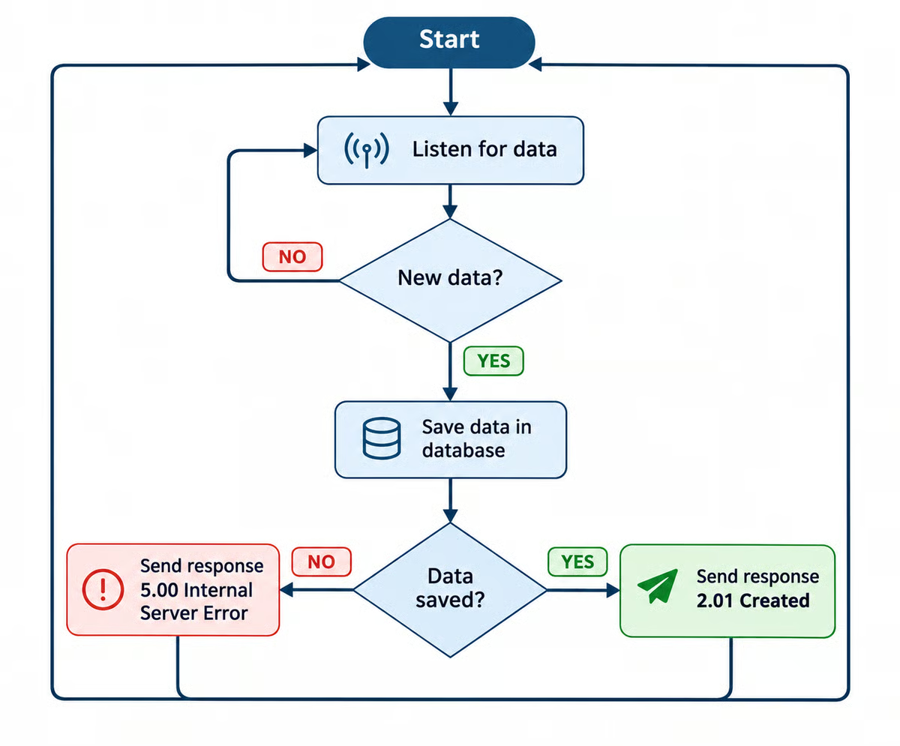
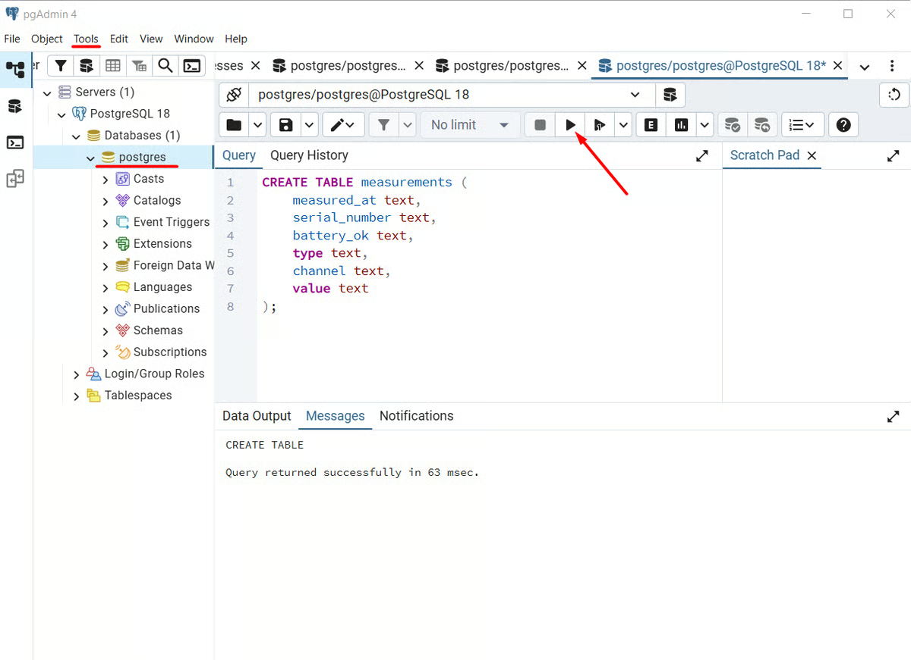
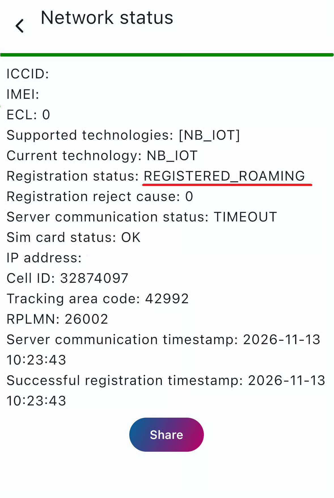
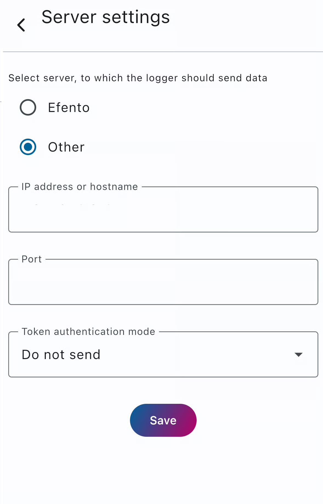
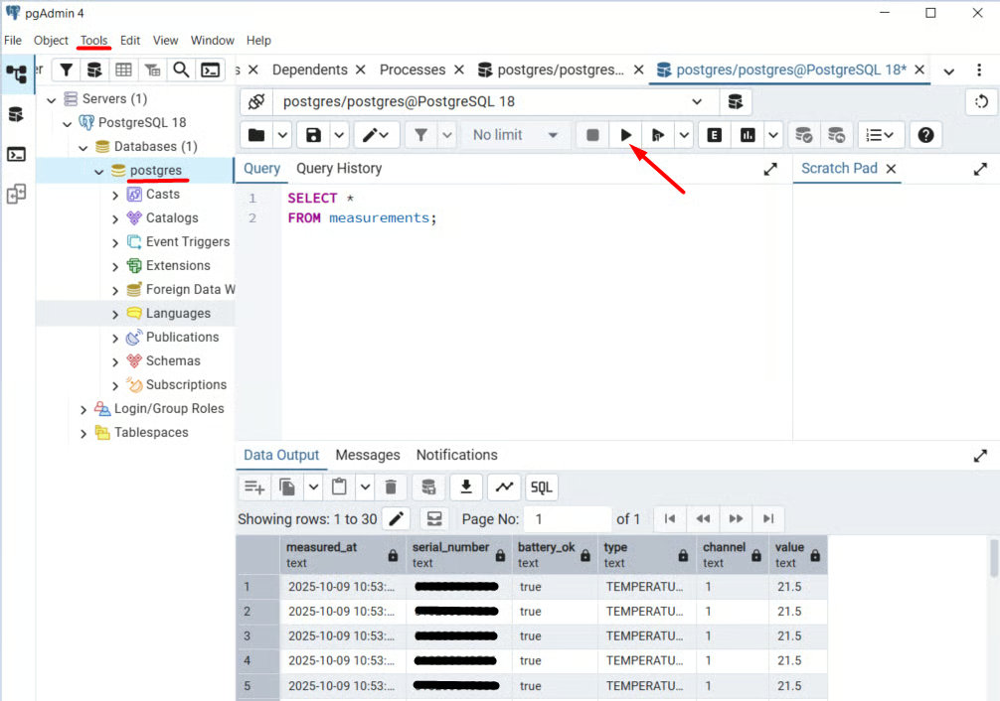
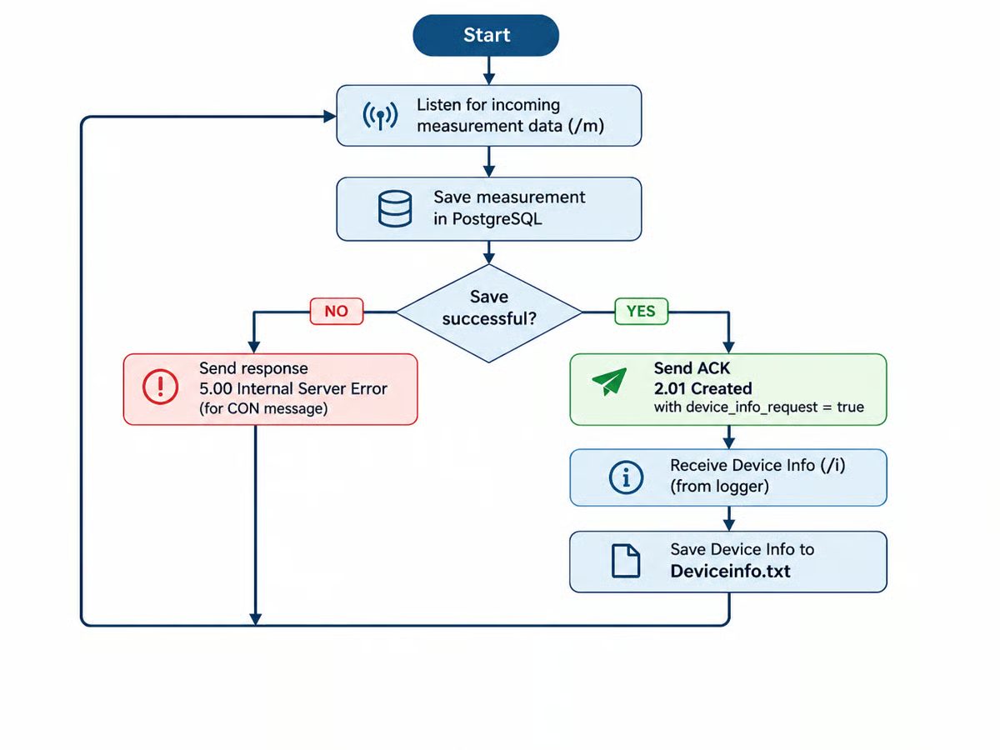

# NB-IoT Loggers Integration

This tutorial explains how to set up a simple CoAP server in Python to receive data from Efento NB-IoT loggers and store measurements in a PostgreSQL database. The example also demonstrates basic two-way communication, including requesting device information, and supports extended configuration messages used by newer Efento devices. Although this tutorial uses Python and PostgreSQL, the same approach can be implemented using other programming languages and databases.

If you have any questions or encounter issues, please contact us at [help.efento.io](https://help.efento.io/).

## How does it work?

### Measurement Processing and Server Responses

Efento NB-IoT loggers communicate with the server using CoAP (Constrained Application Protocol), while the transmitted data is encoded using Protocol Buffers (Protobuf). CoAP is a lightweight protocol designed for devices with limited resources, and Protobuf provides a compact binary format for serializing structured data. Together, they reduce communication overhead and the amount of data transmitted over the NB-IoT network, helping minimize energy consumption and support a battery lifetime of up to 8 years, depending on operating conditions.

The Python application provided in this repository runs a CoAP server that continuously listens for incoming messages from Efento NB-IoT loggers. When a measurement message arrives, the server decodes the Protobuf payload, extracts the measurement values and stores them in a PostgreSQL database.

For confirmable measurement messages, the server sends a CoAP response with code **2.01 Created** after successfully processing and saving the received data. If an error occurs while saving measurements to PostgreSQL, the server returns **5.00 Internal Server Error** instead. This error handling applies to database operations performed by the example script; other failures, such as losing the database connection before processing a message, may require additional error handling. The error response allows the logger to recognize that the transmission was not completed successfully and retry sending the data according to its retry mechanism.

The diagram below illustrates the measurement handling process, from receiving a message to sending a response to the logger.



*Figure 1. CoAP measurement processing and server response flow.*

> **Important:** The server's response time should be kept as short as possible. In this example, measurements are saved directly to PostgreSQL before the confirmation is sent. In production environments, a message queue or another asynchronous processing mechanism is recommended to reduce response delays and avoid unnecessary battery consumption.

For more information about CoAP and Protobuf, visit the [Efento Knowledge Library](https://getefento.com/libraries/).

### Other Message Types

In addition to measurement data, Efento NB-IoT loggers send several types of messages to the server, including configuration updates, diagnostic information and time synchronization requests. These messages allow the server to monitor device operation, receive configuration information and support communication with the loggers.

The following message types are supported by the example CoAP server:

- **Configuration (`/c`)** – These messages are sent by the logger to synchronize its configuration with the server. When the logger starts up, it sends its current configuration to the server. Subsequently, configuration messages are sent whenever the user changes the device settings via Bluetooth or when the logger reports an error to the server (including the corresponding error code). If a Configuration message contains an error code, it is confirmable and must be acknowledged by the server. Otherwise, Configuration messages are non-confirmable.
- **Device Info (`/i`)** – These messages contain detailed information about the device, including radio communication parameters and battery statistics. The logger sends a Device Info message at startup or in response to a request from the server. The initial Device Info message sent at startup is confirmable and must be acknowledged by the server. Device Info messages sent in response to a server request are non-confirmable.
- **Time (`/t`)** – These messages are sent when the logger needs to obtain the current time from the server. The logger sends a Time request only if it is unable to retrieve the current time from the cellular network. Time requests are always confirmable, and the server returns the current timestamp in the payload of its response.
- **Extended Configuration (`/e`)** *(available from software version 7.0.0 onwards)* – These messages contain additional information about the device configuration, including the logger name, extended configuration hash and calibration parameters. The logger sends an Extended Configuration message when relevant settings are changed via Bluetooth using the Efento mobile application.

In this example, measurement data is stored in a PostgreSQL database, while Configuration, Device Info and Extended Configuration messages are decoded and saved to separate text files for inspection. Time requests are handled by returning the current timestamp in the server's response.

In production integrations, Configuration and Device Info messages do not necessarily need to be stored or processed. However, the server must acknowledge every confirmable message received from the logger with an appropriate CoAP response (ACK with code **2.01 Created** in this example).

## Before you start

Before following this tutorial, make sure you have the following software installed:

- **Python 3** – Required to run the CoAP server.
- **Python IDE or code editor** – Such as Visual Studio Code, PyCharm or another editor that supports Python.
- **PostgreSQL** – Used to store measurements received from Efento NB-IoT loggers. The pgAdmin tool is recommended for database configuration and management.
- **Protocol Buffers compiler (`protoc`)** – Required to generate Python classes from Efento's `.proto` files.

You will also need:

- **Efento NB-IoT logger**
- **Efento Protocol Buffers definitions** – Available in the [Proto-files repository](https://github.com/efento/Proto-files).

The required Python libraries and their installation are covered in the **CoAP Server** section.

> The commands in this tutorial are demonstrated on Windows. Some commands and file paths may differ depending on your operating system.

## PostgreSQL database

PostgreSQL is used to store measurement data received from Efento NB-IoT loggers.

Download and install PostgreSQL from the [official website](https://www.postgresql.org/download/). During installation, you will be asked to set a password for the `postgres` database user. Make sure to save this password, as it will be required when configuring the CoAP server.

The installation typically includes **pgAdmin**, a graphical tool for managing PostgreSQL databases. We will use it to create the `measurements` table and verify that the logger data has been stored correctly.

For a local installation, the following database settings can be used:

```dotenv
DATABASE_HOST=localhost
DATABASE_PORT=5432
DATABASE_USER=postgres
DATABASE_PASSWORD=your_password_here
DATABASE_NAME=postgres
```

Replace `your_password_here` with the password you set during installation. If you use a different database name, username or port, adjust these values accordingly.

These settings will later be added to the `.env` file used by the Python server.

### Create Table

To store measurements received from Efento NB-IoT loggers, you need to create a table in your PostgreSQL database.

In this example, we use a simple table named `measurements` with six columns. All columns use the `text` data type to accommodate measurements from different types of sensors.

> This database structure is intended for demonstration purposes only. In production environments, the database schema and data types should be selected according to the requirements of your application.

To create the table using pgAdmin:

1. Open pgAdmin and connect to your PostgreSQL server.
2. In the left panel, expand **Servers → PostgreSQL → Databases** and select the database you want to use (in this example, `postgres`).
3. Open **Tools → Query Tool**.
4. Paste the following SQL statement into the Query Editor:

   ```sql
   CREATE TABLE measurements (
       measured_at text,
       serial_number text,
       battery_ok text,
       type text,
       channel text,
       value text
   );
   ```

5. Click **Execute (▶)** to run the query.



*Figure 2. Creating the measurements table in PostgreSQL using pgAdmin.*

If the query executes successfully, PostgreSQL creates an empty table named `measurements`. The CoAP server will use this table to store measurements received from Efento loggers.

## CoAP Server

### Python Dependencies

Before running the CoAP server, install the Python libraries required by the example script:

- **psycopg2-binary** – A PostgreSQL adapter that allows Python applications to connect to the database and store measurement data.
- **aiocoap** – A Python implementation of the CoAP protocol, used to receive messages from Efento NB-IoT loggers and send responses.
- **protobuf** – Used to deserialize the binary messages transmitted by Efento NB-IoT loggers into structured data.
- **python-dotenv** – Loads database credentials and server settings from a local `.env` configuration file.

Open a terminal and install the libraries using the following command:

```powershell
python -m pip install psycopg2-binary aiocoap protobuf python-dotenv
```

The script also uses standard Python modules such as `asyncio`, `base64`, `datetime`, `json` and `os`. These modules are included with Python and do not require separate installation.

### Compiling Protocol Buffers

Protocol Buffers (Protobuf) is a binary serialization format used by Efento NB-IoT loggers to transmit measurement data, device information and configuration messages. Unlike text-based formats such as JSON or XML, Protobuf uses a compact binary representation, reducing the amount of data transmitted.

To decode these messages, the server needs Python classes generated from Efento's Protocol Buffers definitions (`.proto` files). These definitions describe the structure of messages, including field names, types and identifiers.

1. **Download the Protocol Buffers compiler**

   Download the compiler (`protoc`) for your operating system from the [official Protocol Buffers releases page](https://github.com/protocolbuffers/protobuf/releases).

   For Windows, download the appropriate `protoc-...-win64.zip` archive and extract it. The compiler executable is located in the `bin` folder.

2. **Download Efento's Protobuf definitions**

   Download the `.proto` files from the [Efento Proto-files repository](https://github.com/efento/Proto-files) by selecting **Code → Download ZIP**, then extract the archive.

   The repository contains seven definitions required by this example:

   - `proto_measurement_types.proto`
   - `proto_measurements.proto`
   - `proto_config_types.proto`
   - `proto_config_rule.proto`
   - `proto_config.proto`
   - `proto_extended_configuration.proto`
   - `proto_device_info.proto`

3. **Generate the Python modules**

   Open a terminal in the folder containing the downloaded `.proto` files.

   Run the following command in PowerShell, replacing the example paths with the actual locations of your compiler and project:

   ```powershell
   & "C:\path\to\protoc.exe" --proto_path=. --python_out="C:\path\to\NB-IoT-loggers-integration-main\protobuf" proto_measurement_types.proto proto_measurements.proto proto_config_types.proto proto_config_rule.proto proto_config.proto proto_extended_configuration.proto proto_device_info.proto
   ```

   The compiler generates seven Python modules ending in `_pb2.py` and saves them directly in the project's `protobuf` folder.

4. **Verify the generated files**

   Check that the `protobuf` folder contains the following files:

   ```text
   protobuf/
   ├── proto_measurement_types_pb2.py
   ├── proto_measurements_pb2.py
   ├── proto_config_types_pb2.py
   ├── proto_config_rule_pb2.py
   ├── proto_config_pb2.py
   ├── proto_extended_configuration_pb2.py
   └── proto_device_info_pb2.py
   ```

   These modules are required to run the example server. They are not included in the integration repository and must be generated before starting the application.

### Running the CoAP Server

Once the required Python libraries are installed and the Protobuf modules have been generated, you can configure and start the CoAP server.

1. **Configure the environment file**

   In the project directory, locate the `.env.example` file and create a copy named `.env`.

   Open `.env` in a text editor and update the settings:

   ```dotenv
   # PostgreSQL database configuration
   DATABASE_HOST=localhost
   DATABASE_PORT=5432
   DATABASE_USER=postgres
   DATABASE_PASSWORD=your_password_here
   DATABASE_NAME=postgres

   # CoAP server configuration
   COAP_HOST=127.0.0.1
   COAP_PORT=5683
   ```

   Replace the database credentials with the values configured during PostgreSQL installation.

   For `COAP_HOST`, enter the local IP address of the computer running the server. For a local-only setup, you can use `127.0.0.1`. **Before testing communication with a physical NB-IoT logger, replace `127.0.0.1` with the computer's local network IP address**, so the server can receive incoming traffic from the NB-IoT network.

   `COAP_PORT` specifies the UDP port on which the server listens. You can use `5683`, the standard CoAP port, or another available UDP port. Make sure the selected port is permitted by your firewall and correctly forwarded by your router if necessary.

2. **Start the CoAP server**

   Open a terminal in the project directory and run:

   ```powershell
   python .\NB-IoT-sensors-integration-2-way-communication.py
   ```

   Keep the terminal open while the server is running. The server listens for incoming CoAP messages and processes them according to their endpoint.

   If you need to stop the server, you can do so at any time by pressing **Ctrl+C** in the terminal where it is running.

3. **Verify that the server is listening**

   Open a second terminal. On Windows, you can use the following PowerShell command:

   ```powershell
   Get-NetUDPEndpoint -LocalPort 5683
   ```

   Replace `5683` with the value configured in `COAP_PORT`. On other operating systems, different commands may be required to check whether the server is listening on the specified port.

   If the server is running correctly, the command should display a UDP endpoint with the configured local address and port.

   > A successfully started server does not necessarily mean that it is reachable from the NB-IoT network. The destination address, firewall rules and any required UDP port forwarding must also be configured correctly.

## NB-IoT Logger Configuration

Configuration of Efento NB-IoT loggers is performed using the Efento mobile application, available from [Google Play](https://play.google.com/store/apps/details?id=pl.efento.cloud) / [App Store](https://apps.apple.com/pl/app/efento/id6479740909).

### Check the NB-IoT Network Connection

Before configuring the destination server, make sure the logger is registered with the NB-IoT network and that its APN settings allow communication with the server.

To check the network connection:

1. Open the Efento mobile application and select **Nearby devices**.
2. Connect to your NB-IoT logger via Bluetooth.
3. Tap the **gear icon** in the upper-right corner to open the device settings.
4. Under **Diagnostics**, select **Network status**.
5. Check the **Registration status** field. It should display either `REGISTERED` or `REGISTERED_ROAMING`.



These statuses indicate that the logger is registered with the cellular network, but they do not necessarily mean that it can successfully communicate with your CoAP server.

### Configure the Destination Server

To configure the logger to send data to your own CoAP server:

1. Connect to the logger in the **Nearby devices** section of the Efento mobile application.
2. Tap the **gear icon** in the upper-right corner to open the device settings.
3. Under **Cellular**, select **Server settings**.
4. Select **Other** as the destination server.
5. Enter the IP address or hostname of your CoAP server in the **IP address or hostname** field.
6. Enter the server's UDP port in the **Port** field. This must match the public port configured for your server.
7. Under **Token authentication mode**, select the appropriate option. For this example, choose **Do not send**.
8. **Save** the settings to apply the new server configuration.



To verify communication with your CoAP server without waiting for the next scheduled transmission, go back to the device settings and select **Cellular → Trigger transmission** to manually initiate data transmission.

If the CoAP server is running on a computer behind a router, make sure the selected UDP port is correctly forwarded to that computer and that incoming traffic is permitted by the firewall.

### Results

Once the Efento NB-IoT logger has transmitted data to the CoAP server, the received measurements should be stored in the PostgreSQL database.

To view the measurements:

1. Open pgAdmin and connect to your PostgreSQL server.
2. Select the database configured in your `.env` file.
3. Open **Tools → Query Tool**.
4. Enter the following SQL query:

   ```sql
   SELECT * FROM measurements;
   ```

5. Click **Execute (▶)**.

The query displays the measurements received from the logger, including the measurement timestamp, device serial number, battery status, measurement type, channel and value.

If multiple loggers send data to the same server, their measurements are stored in the same table and can be distinguished by the `serial_number` column.



*Figure 5. Measurement data received from Efento NB-IoT loggers and stored in PostgreSQL.*

## Two-Way Communication

Efento NB-IoT loggers support two-way communication, allowing the server not only to receive measurements and diagnostic information but also to send requests and configuration updates to the devices.

To minimize power consumption, Efento NB-IoT loggers initiate communication with the server. When a logger sends a confirmable CoAP message, the server responds with an acknowledgement (ACK), which can also contain a request for the logger to perform a specific action.

The example Python server demonstrates this mechanism by requesting **Device Info** from the logger. This allows the server to retrieve detailed diagnostic information, including firmware version, battery statistics, runtime information and cellular modem parameters.

### Device Info

The Device Info message provides detailed diagnostic information about the logger, including:

- **Device identification:**
  - serial number,
  - software version and commit ID.
- **Runtime information:**
  - uptime,
  - message counters,
  - processor temperature,
  - battery voltage,
  - processor temperature recorded at the lowest battery voltage,
  - battery reset timestamp,
  - maximum and minimum processor temperatures,
  - runtime errors and reset counter.
- **Modem information:**
  - modem type and firmware version,
  - SIM card identification,
  - cellular network and signal parameters, including RSRP, RSRQ, RSSI, SINR and other modem-specific statistics.
- **Memory usage statistics.**

The information received from the logger is decoded and saved to the `Deviceinfo.txt` file in a readable JSON format. The serial number is displayed in hexadecimal format.

> The file is overwritten when a new Device Info message is received, so it contains the most recently received diagnostic information rather than a history of messages.

Modem diagnostic parameters are stored as an array of numerical values. For a detailed explanation of these values for the Quectel BC660 modem, refer to the [`modem_parameters.md`](modem_parameters.md) file located in the main project directory.

### How Does Two-Way Communication Work?

When the logger sends a confirmable measurement message (`/m`), the server processes and saves the received data in PostgreSQL. If the operation succeeds, the server responds with an acknowledgement (ACK) containing the **2.01 Created** response code and the `device_info_request` flag set to `true`.

After receiving this response, the logger sends a separate Device Info message to the `/i` endpoint. The server decodes the message and saves its contents to the `Deviceinfo.txt` file.

This mechanism allows the server to request diagnostic data without establishing a separate connection to the logger.



*Figure 6. Two-way CoAP communication and Device Info request flow.*
